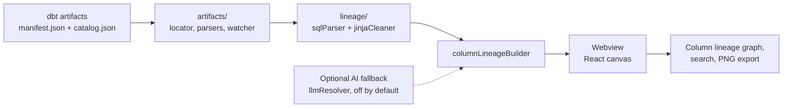

<div align="center">

# VORO Column Flow

**Column-level lineage for dbt projects, right inside VS Code.**

No account. No server. No warehouse connection required. It reads the
`manifest.json` dbt already wrote to disk and draws the graph — that's it.

[](https://marketplace.visualstudio.com/items?itemName=sahbimo.voro-column-flow)
[](https://marketplace.visualstudio.com/items?itemName=sahbimo.voro-column-flow)
[](./LICENSE)

</div>

---

## What this is

dbt tells you which **models** depend on which — but not which **column** feeds
which. When a number looks wrong three models downstream, you're left grepping
SQL by hand to figure out where it came from.

VORO Column Flow answers that directly: pick any model, and see exactly which
column produced which output column, all the way upstream or downstream,
colour-coded by how it was transformed along the way.

Everything is parsed **locally** from files dbt already generates — no data
ever leaves your machine.

## Installation

**Option 1 — from the Extensions panel (recommended)**

1. Open VS Code
2. Go to the Extensions view (`Ctrl+Shift+X` / `Cmd+Shift+X`)
3. Search for **"VORO Column Flow"**
4. Click **Install**

**Option 2 — from the command line**

```bash
code --install-extension sahbimo.voro-column-flow
```

**Option 3 — from a `.vsix` file** (if you were sent the file directly instead
of installing from the Marketplace)

```bash
code --install-extension voro-column-flow-0.3.3.vsix
```

Or in VS Code: Extensions view → `···` menu → **Install from VSIX…**

## Getting started

1. **Generate dbt artifacts** (see below) — this is the only setup step
2. Open your dbt project in VS Code
3. Click the **VORO** icon in the activity bar, or right-click any `.sql` file →
   **Show Lineage for Current Model**
4. Pick a model, then use **↑ up** / **↓ down** to pull in as much lineage as you want
5. Click any column to trace its path across models

### Generating the artifacts

**Required — `target/manifest.json`:**

```bash
dbt compile      # or dbt parse / dbt run / dbt build
```

**Recommended — `target/catalog.json`:**

```bash
dbt docs generate
```

`dbt docs generate` reads your warehouse's `information_schema`, so it needs a live
connection — which is why it is recommended rather than required. It is worth doing:

| | Without `catalog.json` | With `catalog.json` |
|---|---|---|
| Column lists | Inferred from SQL | Exact, from the warehouse |
| Data types | Not shown | Shown |
| Source columns | Inferred from how downstream models use them | Exact |

Most dbt projects declare sources in `sources.yml` without listing their columns.
When that happens the extension infers each source's columns from the SQL that reads
it, so lineage still works — the catalog just replaces guesswork with ground truth.
The toolbar tells you when the catalog is missing.

## Works with any warehouse

The SQL dialect is read from `manifest.metadata.adapter_type`, so the right grammar
is chosen automatically per project — nothing to configure.

Snowflake · BigQuery · Databricks · Redshift · Trino / Presto · Athena · Postgres ·
DuckDB · Fabric / Synapse · SQL Server · MySQL · Hive / Spark

Unrecognised adapters fall back through a generic dialect chain.

## Why it starts empty

Large projects have thousands of models; drawing them all at once is unusable. So
nothing renders until you choose a model, and you decide how far to expand from
there. Both depth steppers default to **0** — one model, nothing else.

Three ways to change the root: the **Choose a model…** picker, clicking a model in
the VORO sidebar, or the **⌖** button on any node header. The current root shows **★**.

## Features

- **Column-level lineage** — traces individual columns, not just model dependencies
- **Transform classification** — edges are colour-coded: passthrough (blue),
  rename (green), transform (orange), aggregate (purple). Grey dashed means dbt
  knows the models are connected but no column mapping could be resolved
- **Column trajectory** — click a column to light up its full path; switch between
  **← Upstream**, **↔ Both**, and **Downstream →**
- **Edge details** — hover any edge for its transform type and SQL expression;
  click to pin a detail panel
- **Column search** — a dedicated **Columns** panel in the toolbar searches
  column names across every model directly; picking a result jumps to that
  model and traces the column's path, same as clicking it in the graph
- **dbt selector syntax** — `+model`, `model+`, `2+model+1` in the search box
- **Layer colours** — inferred from your folder names, including numbered
  conventions like `00_RAW` / `30_ANALYTIC`
- **Live refresh** — the graph updates when `manifest.json` changes
- **Jump to source** — double-click a node header to open its `.sql`

## Requirements

- VS Code 1.85 or later
- A dbt project with `dbt_project.yml` **at its root** and `target/manifest.json`
- dbt 1.0–1.9+ (manifest schema versions 6–12)

## Settings

| Setting | Default | Description |
|---|---|---|
| `voroColumnFlow.targetPath` | `"target"` | Relative path to the dbt target directory |
| `voroColumnFlow.ai.enabled` | `false` | Opt-in AI fallback for edges SQL parsing couldn't resolve — see [AI fallback (optional)](#ai-fallback-optional) |
| `voroColumnFlow.ai.apiFormat` | `"openai"` | Wire format of your endpoint: `openai` (also covers OpenRouter, Groq, Mistral, DeepSeek, Together, Ollama, LM Studio, etc.), `anthropic`, or `azure` (Azure AI Foundry model-catalog/serverless deployments) |
| `voroColumnFlow.ai.baseUrl` | `"https://api.openai.com/v1"` | Base URL of the AI endpoint |
| `voroColumnFlow.ai.model` | `""` | Any model name your endpoint serves, e.g. `gpt-4o-mini`, `claude-haiku-4-5`, `llama3.1` — for `azure`, this is your deployment name |
| `voroColumnFlow.ai.azureApiVersion` | `"2024-05-01-preview"` | Only used when `apiFormat` is `azure`. Check your Foundry deployment's quickstart code for the current value — this default may be outdated |

## Commands

| Command | Description |
|---|---|
| **VORO Column Flow: Show Lineage** | Open the lineage panel |
| **VORO Column Flow: Show Lineage for Current Model** | Open, focused on the active `.sql` file |
| **VORO Column Flow: Refresh** | Re-read the manifest |
| **VORO Column Flow: Switch dbt Project** | Pick a different project in a multi-project workspace |
| **VORO Column Flow: Export as PNG** | Save the current view |
| **VORO Column Flow: Set AI API Key** | Store the API key for the optional AI fallback (VS Code secret storage) |
| **VORO Column Flow: Clear AI API Key** | Remove the stored AI API key |

## Keyboard shortcuts

| Key | Action |
|---|---|
| `F` | Fit graph to screen |
| `Esc` | Clear column selection and pinned edge |
| Double-click node header | Open the model's `.sql` file |
| Click node header | Collapse / expand its column list |

## Troubleshooting

**Nothing loads.** Check that `dbt_project.yml` is at your project **root**, not
inside `target/`. The extension treats whichever folder contains it as the project
root. Then open **View → Output → "VORO Column Flow"** — it prints model, column and
edge counts, the detected dialect, and the parse rate.

**Lots of grey dashed edges.** Those are dependencies where no column mapping could
be resolved. Running `dbt docs generate` is the most effective fix.

## AI fallback (optional)

Some model pairs are connected in dbt's DAG but have no column-level mapping the
SQL parser could resolve (the grey dashed edges). By default nothing is done about
this — the edge just shows as unresolved.

If you turn on `voroColumnFlow.ai.enabled`, an unresolved edge's detail panel gets
a **Resolve with AI** button. Clicking it sends *only that edge's* source/target
model and column names, their data types, and the target model's SQL to the
endpoint you configure (`voroColumnFlow.ai.baseUrl` / `.model` / `.apiFormat`) and
shows back a guess, clearly labelled as AI-generated and never treated as a parsed
fact. Nothing is sent automatically, in bulk, or on load — one click, one edge.

The API key is entered via **VORO Column Flow: Set AI API Key** and stored in VS
Code's secret storage, never in settings.json.

Any OpenAI-compatible or Anthropic-compatible endpoint works, so you can point
this at whichever provider or self-hosted model you choose. Azure AI Foundry
model-catalog/serverless deployments (a `*.services.ai.azure.com` or
`*.models.ai.azure.com` endpoint) are also supported via `apiFormat: "azure"` —
note this is **not** the same as a classic `*.openai.azure.com` resource, which
uses a different auth header and URL shape and isn't supported.

## Privacy

Everything else is parsed locally from files already on disk. Aside from the
opt-in AI fallback above (off by default), the extension makes no network calls
and never connects to your warehouse.

## How it works



Everything runs inside the extension host. The only optional network call is the AI fallback described below.

## Build from source

Requires Node.js 18+ and VS Code 1.85+.

```bash
cd dbt-column-flow
npm ci
npm run build      # bundles the extension with esbuild
npm test           # vitest
npx vsce package   # produces a .vsix you can install locally
```

Press `F5` in VS Code (launch config in `.vscode/`) to run it in an Extension Development Host.

## Contributing

Issues and pull requests are welcome.

## License

[MIT](./LICENSE)
